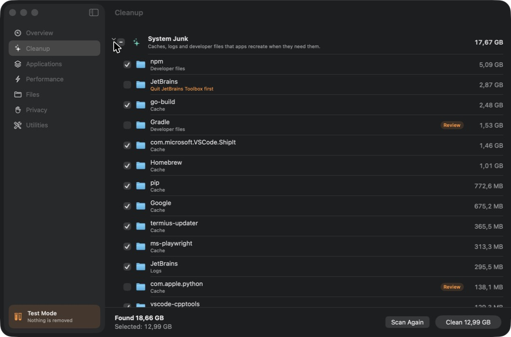
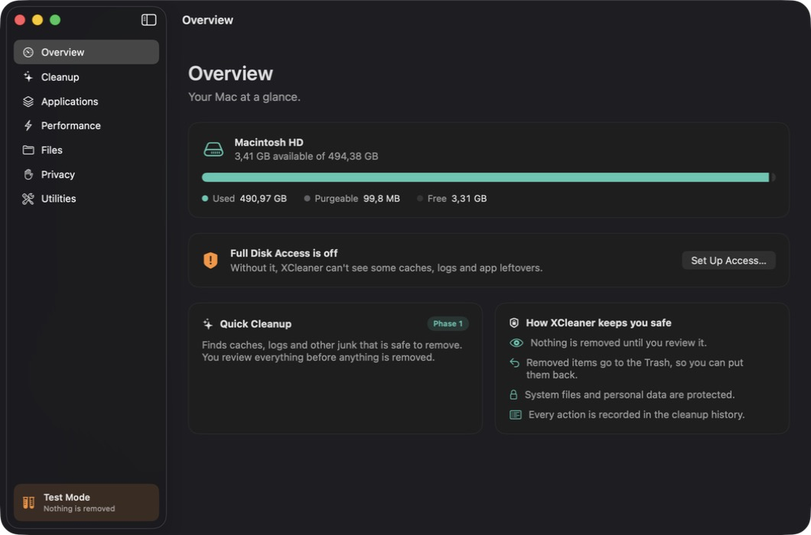
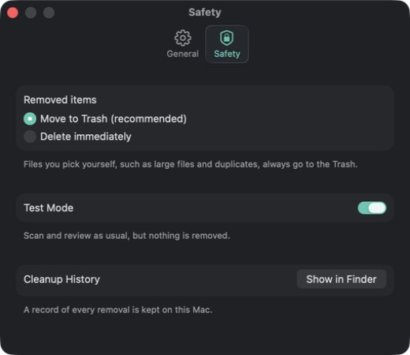

<p align="center">
  
</p>

<h1 align="center">XCleaner</h1>

<p align="center">
  A native macOS cleaner with a clean, safe and simple interface.
</p>

<p align="center">
  
  
  
  
  <a href="LICENSE"></a>
</p>

<p align="center">
  
</p>

## About

XCleaner finds the clutter that builds up on a Mac and helps you remove it without putting anything important at risk. That clutter includes caches, logs, files left behind by deleted apps, old installers and duplicates.

It aims to cover what popular commercial cleaners do, but more calmly and openly. There are no scare tactics and no inflated numbers, and nothing is ever removed behind your back.

> [!NOTE]
> XCleaner is in early development. Cleanup of system junk, installers, downloads and the Trash works today. So do a complete app uninstaller, a finder for files left behind by deleted apps, a disk map, a finder for big files and a full cleanup history. More tools arrive phase by phase, as listed in the [roadmap](#roadmap).

## Safety first

Every removal passes through a single gate that checks the item again right before it is touched.

- **Nothing is removed until you review it.** Scans only produce a list, and you decide what goes.
- **The Trash comes first.** By default removed items go to the Trash, so you can put them back. Files you pick yourself, such as large files or duplicates, always go to the Trash.
- **An allowlist, not a guess.** An item can only be removed from inside the folder its scan looked in. Symlinks are never followed, and `..` tricks are refused.
- **Protected locations stay untouched.** XCleaner never removes macOS system folders, Keychains, iCloud Drive and other cloud storage, Mail, Messages or the Photos library. Automatic cleanup rules never reach into your personal folders, such as Desktop, Documents and Downloads.
- **App bundles stay sealed.** XCleaner never edits files inside an app, so code signatures stay valid.
- **A full history.** Every action is recorded in a local log in `~/Library/Logs/XCleaner` and listed under Utilities.
- **Exclusions.** Folders you add under Settings › Exclusions are never scanned or removed.
- **Apps in use are left alone.** Files that belong to a running app are flagged and left unselected.
- **Test Mode.** Scan and review as usual while nothing is removed. Debug builds start with Test Mode on.
- **Private by design.** Your files never leave your Mac, and XCleaner collects no data.

## Features

| Area | Tools | Status |
|---|---|---|
| Overview | Disk usage, Full Disk Access status, one-click scan | Available |
| Cleanup | System junk, installers and downloads, Trash bins | Available |
| | Mail attachments, system-level junk | Phase 3 |
| Applications | Uninstaller, remaining files of deleted apps, app reset | Available |
| | Extensions | Phase 3 |
| | Updater for apps from developers, the App Store and Homebrew | Phase 4 |
| Performance | Startup items, heavy apps, maintenance tasks | Phase 3 |
| Files | Biggest and old files | Available |
| | Disk map | Available |
| | Duplicates, similar photos | Phase 4 |
| Privacy | Browser data | Phase 3 |
| | App permissions, background item check | Phase 4 |
| Utilities | Cleanup history | Available |
| | Menu bar monitor | Phase 3 |
| | Hidden files | Phase 4 |

## Screenshots

| Overview | Safety settings |
|---|---|
|  |  |

## Requirements

- macOS 14 Sonoma or later
- Xcode 26 or later, to build from source

## Building from source

```bash
git clone https://github.com/xazar-mammadli/XCleaner.git
cd XCleaner
open XCleaner.xcodeproj
```

In Xcode, choose the **XCleaner** scheme and press **Run** (⌘R).

To build from the terminal instead:

```bash
xcodebuild -project XCleaner.xcodeproj -scheme XCleaner -configuration Debug -derivedDataPath .build/DerivedData build
open .build/DerivedData/Build/Products/Debug/XCleaner.app
```

### Full Disk Access

XCleaner needs Full Disk Access to see caches, logs and app leftovers in protected folders. On first launch, the app walks you through granting it under System Settings › Privacy & Security › Full Disk Access.

macOS ties this permission to the app's code signature. Builds that are only signed to run locally get a new signature every time, so you may need to grant the permission again after each build. To avoid that, choose your team under **Signing & Capabilities** in Xcode. A free personal team is enough.

## Running tests

Unit tests cover the safety engine. They run in throwaway folders and never touch your real files:

```bash
swift test --package-path Packages/CleanerCore
```

In Xcode, ⌘U runs the same tests through the XCleaner scheme.

## Project structure

```
XCleaner/
├── App/                        SwiftUI app (interface only)
│   ├── DesignSystem/           Shared components
│   ├── Features/               Overview, onboarding, settings and section screens
│   ├── Navigation/             Sidebar and window layout
│   ├── Resources/              App icon, colors, Localizable.xcstrings
│   └── Support/                Preferences and helpers
├── Packages/CleanerCore/       Cleaning engine (no UI)
│   ├── Sources/CleanerCore/
│   │   ├── Apps/               App inventory, leftovers, remaining files
│   │   ├── Cleaning/           Cleaner, Trash handling, audit log
│   │   ├── DiskMap/            Folder tree and treemap layout
│   │   ├── Model/              Cleanable items and safety levels
│   │   ├── Safety/             SafetyGuard and SafetyPolicy
│   │   ├── Scanning/           Scanners for junk, downloads, the Trash and big files
│   │   └── System/             Full Disk Access check, volume usage
│   └── Tests/CleanerCoreTests/
├── docs/images/                Images used in this README
└── XCleaner.xcodeproj
```

## Localization

The interface is available in English and Azerbaijani. XCleaner follows the macOS language by default, and you can switch under **Settings › General › Language**. All strings are in `App/Resources/Localizable.xcstrings`.

## Roadmap

- [x] **Phase 0: Foundation.** Safety engine, app shell, Full Disk Access guide, settings, English and Azerbaijani.
- [x] **Phase 1: Cleanup basics.** Quick and deep cleanup, biggest and old files, cleanup history, exclusions.
- [x] **Phase 2: Applications and disk map.** Uninstaller, remaining files, app reset, disk map.
- [ ] **Phase 3: System tools.** A secure privileged helper, system-level junk, maintenance, startup items, heavy apps, extensions, browser data and a menu bar monitor.
- [ ] **Phase 4: Advanced tools.** Duplicates, similar photos, updater, app permissions, background item check and hidden files.
- [ ] **Phase 5: Release.** Developer ID signing, notarization, automatic updates and a DMG installer.

## Contributing

Issues and pull requests are welcome. For larger changes, please open an issue first to discuss them. Any code that removes files must go through `Cleaner` and `SafetyGuard` and must come with tests.

## License

XCleaner is available under the MIT License. See [LICENSE](LICENSE) for details.
